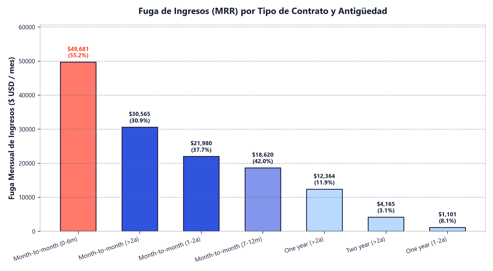
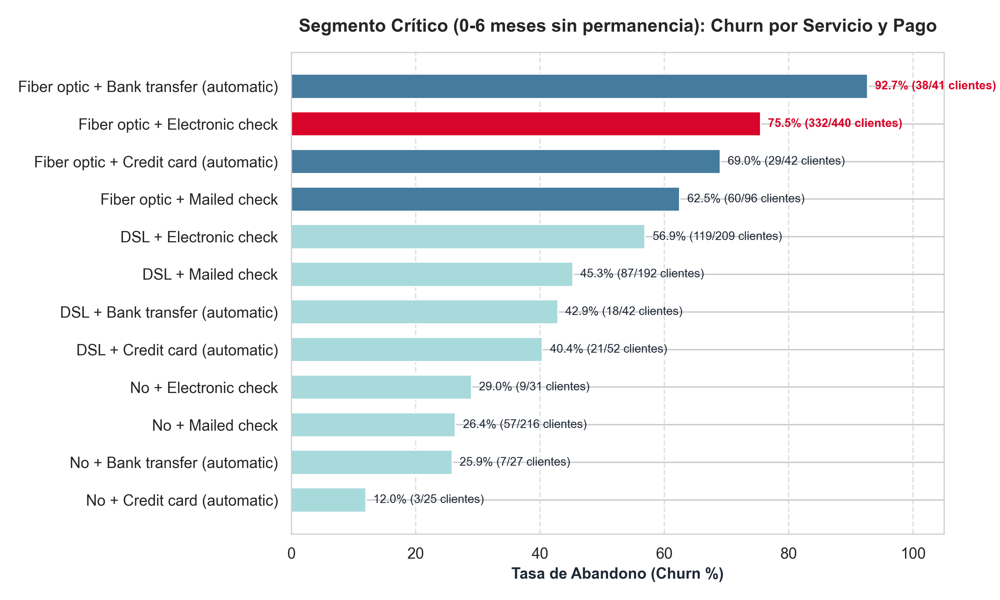
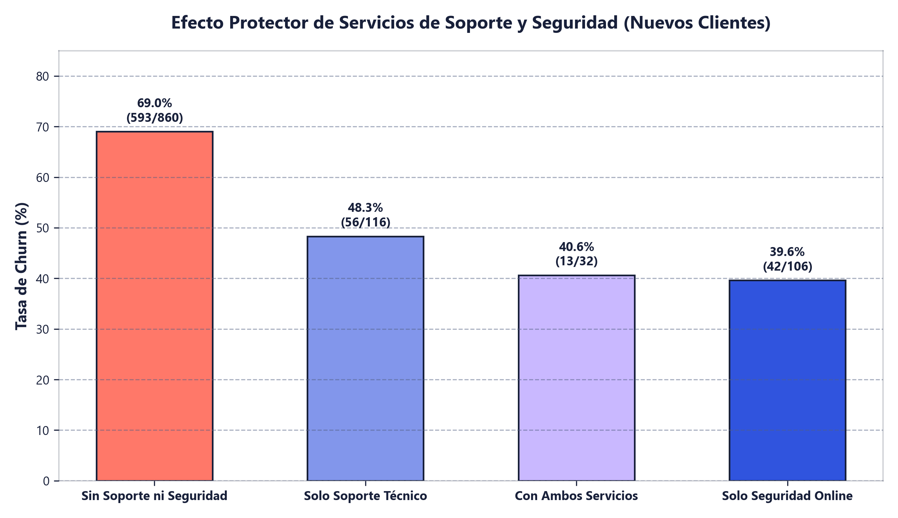
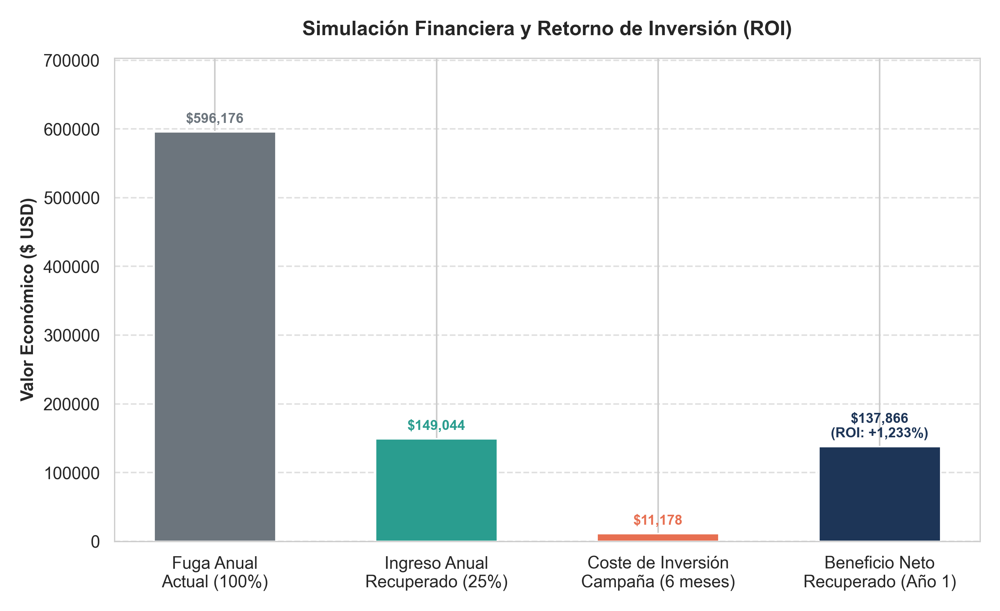

# 📑 Informe Ejecutivo: Estrategia de Retención y Fuga de Ingresos (Telco Churn)

> **Autor:** David Álvarez  
> **Área:** Análisis de Datos & Estrategia Cuantitativa  
> **Repositorio de Código:** [github.com/Dalvarez78/telco-churn-sql](https://github.com/Dalvarez78/telco-churn-sql)

---

## 1. Resumen Ejecutivo

En las industrias de suscripción, el coste de adquisición de clientes (CAC) supera habitualmente entre 5 y 7 veces el coste de retención. Cuando un cliente abandona el servicio prematuramente, no solo se destruye el valor del ciclo de vida del cliente (*Customer Lifetime Value - LTV*), sino que las inversiones iniciales de instalación y captación quedan sin amortizar.

En este estudio analizo la telemetría de **7,043 clientes** de una compañía de telecomunicaciones utilizando **SQL Relacional (SQLite) y Python**. Mi objetivo fue aislar con rigor estadístico y contable el foco que concentra las mayores pérdidas económicas, identificar las causas raíz que motivan la baja y modelar una estrategia de retención accionable y de alto retorno.

### Resultados Clave del Diagnóstico:
* **Fuga Total de Ingresos:** La compañía experimenta una pérdida recurrente mensual (MRR) de **$139,130.85 USD/mes**, equivalente a **$1,669,570.20 USD anuales**.
* **El Foco Crítico:** El **35.7% de todas las pérdidas monetarias** se concentra en un único segmento: **clientes en contrato mensual (*Month-to-month*) durante sus primeros 6 meses**. Este grupo sufre un abandono del **55.2%**, costando a la empresa **$49,681.30 USD cada mes** ($596,175.60 USD al año).
* **Causa Raíz Operativa:** El nicho con mayor tasa de deserción es la combinación de **Fibra Óptica + Pago mediante Cheque Electrónico (`Electronic check`)**, con un **75.5% de abandono**. El 76% de los clientes cancelados en este segmento carecía además de soporte técnico y ciberseguridad.
* **Modelo Financiero de Retención:** Diseñé una intervención proactiva en el tercer mes (día 75) que, con una meta prudente de retener solo al 25% de los clientes en riesgo, genera un **beneficio neto de $137,865.61 USD** en su primer año con un **ROI proyectado del +1,233.3%**.

---

## 2. Diagnóstico Cuantitativo: Fuga de Ingresos por Contrato y Antigüedad

Para determinar dónde actuar con mayor prioridad, evalué el cruce entre la modalidad contractual de permanencia y los meses de relación comercial (`tenure`):

| Tipo de Contrato | Rango de Antigüedad | Total Clientes | Clientes Cancelados | Tasa de Churn (%) | Fuga Mensual (MRR USD) | % del Total de Fuga |
| :--- | :--- | :--- | :--- | :--- | :--- | :--- |
| **Month-to-month** | **0-6 meses** | **1,413** | **780** | **55.2%** | **$49,681.30** | **35.7%** |
| Month-to-month | Más de 2 años | 1,144 | 353 | 30.9% | $30,565.35 | 22.0% |
| Month-to-month | 1-2 años | 737 | 278 | 37.7% | $21,980.30 | 15.8% |
| Month-to-month | 7-12 meses | 581 | 244 | 42.0% | $18,620.15 | 13.4% |
| One year | Más de 2 años | 1,152 | 137 | 11.9% | $12,364.30 | 8.9% |
| Two year | Más de 2 años | 1,537 | 48 | 3.1% | $4,165.30 | 3.0% |
| One year | 1-2 años | 197 | 16 | 8.1% | $1,101.35 | 0.8% |
| One year | 7-12 meses | 85 | 9 | 10.6% | $438.00 | 0.3% |
| One year | 0-6 meses | 39 | 4 | 10.3% | $214.80 | 0.2% |
| Two year | 0-6 meses | 29 | 0 | 0.0% | $0.00 | 0.0% |
| Two year | 1-2 años | 90 | 0 | 0.0% | $0.00 | 0.0% |
| Two year | 7-12 meses | 39 | 0 | 0.0% | $0.00 | 0.0% |

### Conclusiones del Diagnóstico:
1. **La permanencia contractual es el principal blindaje del negocio:** Los contratos anuales y bianuales presentan tasas de abandono mínimas (8-11% y 0-3%).
2. **El riesgo se concentra en el primer semestre:** En contratos mensuales sin permanencia, el 55.2% de los clientes se da de baja antes de cumplir 6 meses. Es el punto de intervención prioritario.

---

## 3. Radiografía del Segmento Crítico: Servicios y Canal de Pago

Al aislar exclusivamente a la cohorte vulnerable (contrato mensual y $\le$ 6 meses), analicé la combinación del servicio de conectividad con el canal de cobro:

| Servicio de Internet | Método de Pago | Total Clientes | Cancelaciones | Tasa Churn (%) | MRR Perdido ($ USD) | Cuota Media ($) |
| :--- | :--- | :--- | :--- | :--- | :--- | :--- |
| **Fiber optic** | **Electronic check** | **440** | **332** | **75.5%** | **$26,920.80** | **$80.80** |
| DSL | Electronic check | 209 | 119 | 56.9% | $5,213.10 | $45.63 |
| DSL | Mailed check | 192 | 87 | 45.3% | $3,964.40 | $45.97 |
| Fiber optic | Mailed check | 96 | 60 | 62.5% | $4,731.40 | $79.36 |
| Fiber optic | Bank transfer (auto) | 41 | 38 | 92.7% | $3,098.65 | $81.59 |
| Fiber optic | Credit card (auto) | 42 | 29 | 69.0% | $2,399.30 | $80.81 |
| DSL | Credit card (auto) | 52 | 21 | 40.4% | $1,006.15 | $49.71 |
| DSL | Bank transfer (auto) | 42 | 18 | 42.9% | $816.00 | $48.84 |
| Sin Internet | Mailed check | 216 | 57 | 26.4% | $1,144.85 | $20.26 |
| Sin Internet | Electronic check | 31 | 9 | 29.0% | $179.35 | $20.05 |

### Factores Causales Identificados:
* **Fricción mensual en el pago:** El cheque electrónico obliga al usuario a realizar una acción manual cada mes frente al cobro domiciliado automático. Cada factura abre una ventana de fricción y reconsideración.
* **Sensibilidad al precio de la Fibra:** Los clientes con fibra pagan cuotas de ~$80-$90 USD frente a los ~$45 USD del DSL. Al recibir las primeras facturas sin haber consolidado el hábito del servicio, deciden cancelar.

---

## 4. Diagnóstico Causal: Servicios de Soporte y Ciberseguridad

Al examinar la posesión de servicios de asistencia técnica y seguridad dentro del segmento crítico, los datos revelan una clara vulnerabilidad inicial:

| Soporte Técnico | Seguridad Online | Total Clientes | Cancelaciones | Tasa de Churn (%) | Fuga Mensual ($ USD) |
| :--- | :--- | :--- | :--- | :--- | :--- |
| **Sin Soporte Técnico** | **Sin Seguridad Online** | **860** | **593** | **69.0%** | **$40,638.40** |
| Sin Internet | Sin Internet | 299 | 76 | 25.4% | $1,531.50 |
| Con Soporte Técnico | Sin Seguridad Online | 116 | 56 | 48.3% | $4,004.80 |
| Sin Soporte Técnico | Con Seguridad Online | 106 | 42 | 39.6% | $2,684.50 |
| **Con Soporte Técnico** | **Con Seguridad Online** | **32** | **13** | **40.6%** | **$822.10** |

* De los 780 clientes que cancelaron en el segmento crítico, **593 usuarios (el 76%) carecían de ambos servicios**.
* Los clientes sin soporte presentan una deserción del **69.0%**, mientras que disponer de asistencia reduce notablemente el abandono.

---

## 5. Simulación Financiera y Retorno de Inversión (ROI)

A través de una consulta SQL con expresiones de tabla comunes (`WITH ... CTE`), modelé la viabilidad económica de una campaña de retención temprana dirigida a rescatar el 25% de los clientes en riesgo de este segmento crítico:

| Concepto Financiero | Valor Calculado |
| :--- | :--- |
| **Fuga Anual Actual en el Segmento Crítico** | $596,175.60 USD / año |
| **Clientes en Riesgo** | 780 clientes |
| **Meta Conservadora de Rescate (25%)** | 195 clientes |
| **Ingresos Anuales Protegidos (Año 1)** | $149,043.90 USD |
| **Coste Comercial de la Campaña (15% descuento x 6 meses)** | $11,178.29 USD |
| **Beneficio Neto Año 1** | **$137,865.61 USD** |
| **Retorno sobre la Inversión (ROI)** | **+1,233.3%** |

---

## 6. Plan de Acción Recomendado

1. **Disparador Automatizado (Día 75 / Mes 3):**  
   Configurar una regla en el CRM comercial que filtre a clientes de fibra óptica en contratos mensuales que paguen mediante cheque electrónico y lleven entre 60 y 75 días en la compañía.
2. **Oferta de Retención Condicionada:**  
   Ofrecer un **15% de descuento en la factura durante 6 meses**, vinculado contractualmente a:
   - Migración a un **contrato de permanencia anual (One-year contract)**.
   - Activación de pago mediante **domiciliación bancaria o tarjeta automática**.
3. **Kit de Onboarding y Fidelización:**  
   Bonificar durante los primeros 3 meses el paquete de **Soporte Técnico y Seguridad Web** para asegurar que el cliente supera con éxito la fase de adopción del servicio.

---

*Informe elaborado con análisis reproducible en SQLite y Python. Para consultar el código y las consultas SQL completas, revise el repositorio.*
