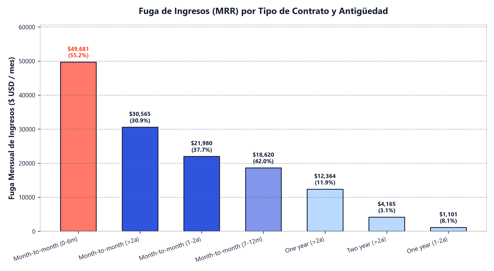
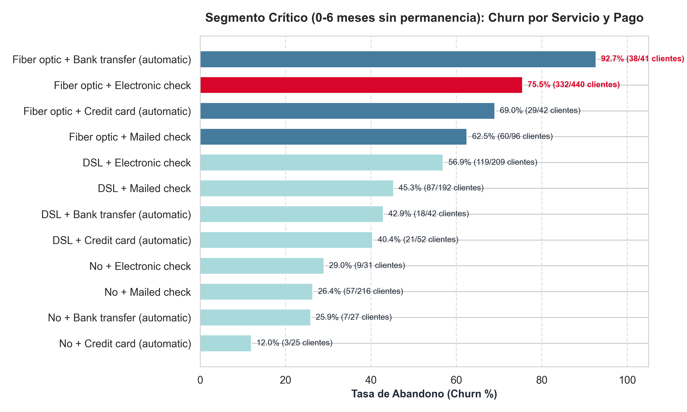
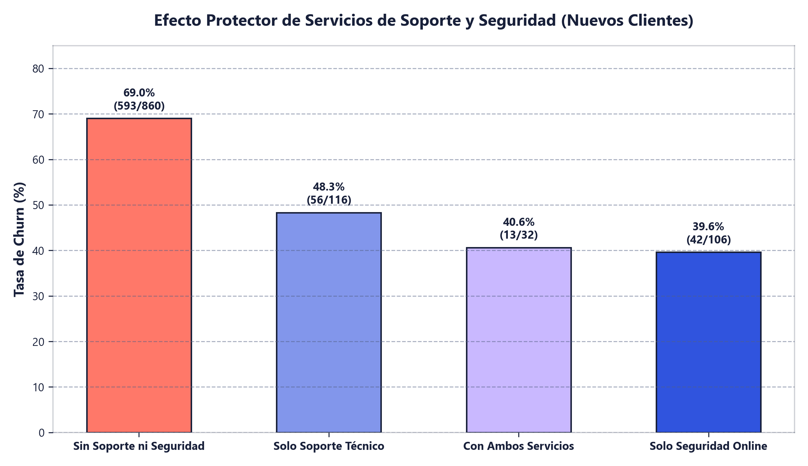
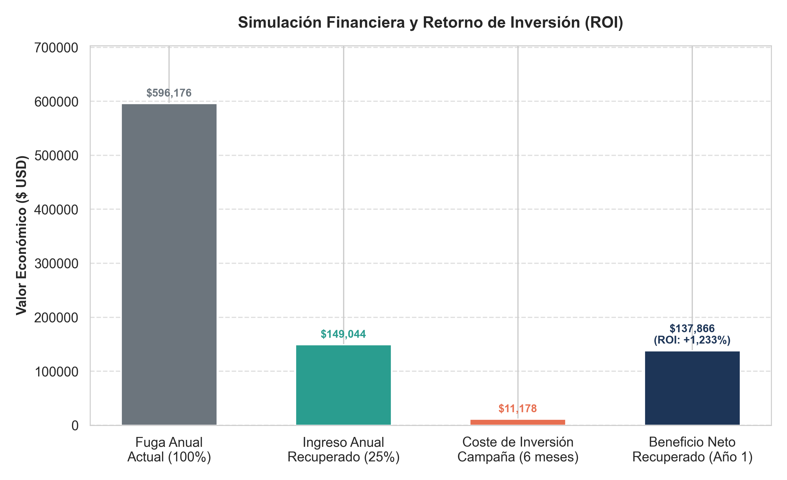

# 💼 Dossier Ejecutivo para Recruiters y Hiring Managers

> **Proyecto:** Análisis Estratégico de Retención de Clientes (Telco Customer Churn con SQL)  
> **Candidato:** David Álvarez — Data Analyst / Analytics Engineer  
> **Portfolio Interactivo:** [Ver Proyecto en mi Web de Lovable](https://tu-portfolio-lovable.app) *(Reemplaza con tu URL de Lovable)*  
> **Repositorio de GitHub:** [github.com/Dalvarez78/telco-churn-sql](https://github.com/Dalvarez78/telco-churn-sql)

---

## ⚡ El "Pitch" en 30 Segundos

En las empresas de suscripción y telecomunicaciones, **adquirir un cliente nuevo cuesta entre 5 y 7 veces más que retener a uno existente**. 

En este proyecto analizo un conjunto de telemetría de **7,043 clientes** utilizando **SQL Relacional (SQLite) y Python**. En lugar de limitarme a reportar estadísticas descriptivas, identifico con precisión quirúrgica el **punto crítico de fuga de ingresos**: los clientes en contratos mensuales con menos de 6 meses de antigüedad sufren un **55.2% de abandono**, provocando una pérdida directa de **$49,681.30 USD al mes** ($596,175.60 USD anuales).

A través de consultas multidimensionales descubro que el segmento más sangrante es **Fibra Óptica + Cheque Electrónico + Sin Soporte Técnico** (hasta un **75.5% de churn**). Concluyo el análisis modelando una **estrategia de retención temprana con un ROI proyectado del +1,233%**, demostrando mi capacidad para transformar datos en decisiones de negocio rentables.

---

## 🎯 Competencias Clave Demostradas

| Competencia | Cómo se demuestra en este proyecto |
| :--- | :--- |
| **SQL Avanzado y Analítico** | Agregaciones condicionales (`COUNT(CASE WHEN...)`), expresiones de tabla comunes (`WITH ... CTE`), cálculo de porcentajes dinámicos sobre subconsultas, lógica condicional (`CASE WHEN`), agrupaciones multidimensionales. |
| **Ingeniería de Datos y ETL** | Limpieza de valores nulos y formatos erróneos en Python (`pandas`), tipado estricto, persistencia en base de datos relacional y creación de índices relacionales (`CREATE INDEX`) para optimizar el rendimiento de lectura. |
| **Visión Estratégica y Negocio** | Traducción directa de datos operativos a KPIs de negocio: **MRR** (Monthly Recurring Revenue), **ARR** (Annual Recurring Revenue), **Tasa de Churn**, **Coste de Retención** y **ROI**. |
| **Data Storytelling y Visualización** | Generación automatizada de gráficos ejecutivos de alta calidad (300 DPI) para stakeholders no técnicos, informes en Markdown y dashboards listos para su integración en Lovable. |
| **Código Limpio y Buenas Prácticas** | Modularidad de código en `src/`, control de versiones en Git con commits semánticos, gestión de dependencias (`requirements.txt`), wrappers de ejecución y notebooks reproducibles paso a paso. |

---

## 📊 Preguntas Clave de Entrevistas Técnicas Respondidas con este Proyecto

### 1. ¿Cómo identificaste la prioridad número 1 para el equipo de Retención?
> **Respuesta:** No miré únicamente el volumen de bajas ni la tasa porcentual en abstracto. Crucé la tasa de churn con los **ingresos mensuales perdidos (MRR)**. Aunque existen segmentos con cierto nivel de churn, el grupo de contratos mensuales con 0 a 6 meses de antigüedad concentra por sí solo el **35.7% de todas las pérdidas monetarias de la compañía** ($49,681.30 USD/mes). Resolver este segmento genera el máximo impacto por cada hora invertida.

### 2. ¿Cuál es la causa raíz (*root cause*) del abandono temprano?
> **Respuesta:** Al profundizar en los datos detecté tres palancas interconectadas:
> 1. **Fricción en el pago:** El método `Electronic check` exige una acción manual cada mes frente al débito automático. El cliente evalúa mes a mes su factura alta de fibra óptica y decide cancelar.
> 2. **Carencia de soporte y seguridad:** El **76%** de los clientes que cancelaron en este segmento no tenían ni Soporte Técnico ni Seguridad Online contratados (tasa de churn del 69% vs 39% cuando cuentan con ambos).
> 3. **Falta de permanencia contractual:** El contrato mes a mes deja la puerta abierta sin barreras de salida.

### 3. ¿Cómo calculaste el ROI del +1,233%?
> **Respuesta:** Mediante una CTE en SQL (`04_simulacion_roi_retencion.sql`):
> * **Fuga Anual Actual:** $49,681.30 $\times$ 12 = **$596,175.60 USD**.
> * **Meta Conservadora de Retención (25%):** Salvar a 195 clientes = **$149,043.90 USD** en ingresos anuales protegidos.
> * **Coste de la Campaña:** 15% de descuento en la factura durante 6 meses para los clientes retenidos = **$11,178.29 USD**.
> * **Beneficio Neto:** $149,043.90 - $11,178.29 = **$137,865.61 USD**.
> * **ROI:** $\frac{137,865.61}{11,178.29} \times 100 = \mathbf{1,233.3\%}$.

---

## 📈 Gráficos Ejecutivos para Revisión Inmediata

### Gráfico 1: Fuga de Ingresos por Tipo de Contrato y Antigüedad

### Gráfico 2: Segmento Crítico por Servicio y Método de Pago

### Gráfico 3: Efecto Protector de Soporte Técnico y Seguridad

### Gráfico 4: Simulación Financiera y Retorno sobre la Inversión (ROI)

---

## 🛠️ Cómo Navegar y Evaluar este Proyecto

1. **Si quieres ver la ejecución de código en 2 clics:**
   Abre el cuaderno interactivo [`analisis_sql.ipynb`](analisis_sql.ipynb) donde cada celda cuenta con su consulta SQL, tabla de datos y análisis de negocio comentado.
2. **Si quieres revisar las consultas SQL puras:**
   Revisa la carpeta [`queries/`](queries/) con las consultas numeradas y comentadas con la lógica de negocio.
3. **Si quieres ver el informe exportado para stakeholders:**
   Lee el archivo [`outputs/informe_de_analisis.md`](outputs/informe_de_analisis.md).
4. **Si quieres ver el proyecto en mi web interactiva de Lovable:**
   Haz clic en [mi Web de Lovable](https://tu-portfolio-lovable.app).

---

*Desarrollado con rigor analítico, buenas prácticas de ingeniería de software y enfoque directo al valor de negocio.*

