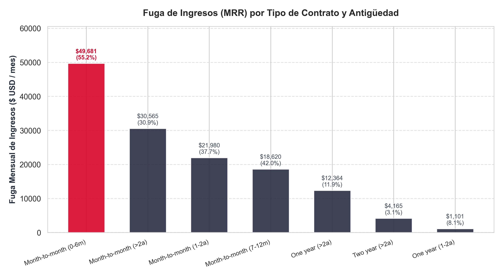
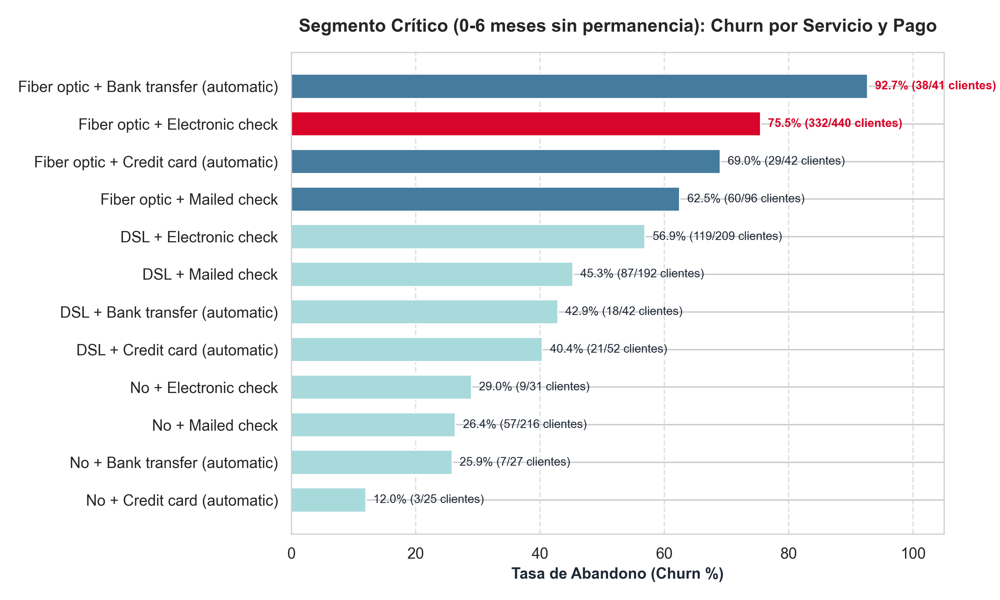
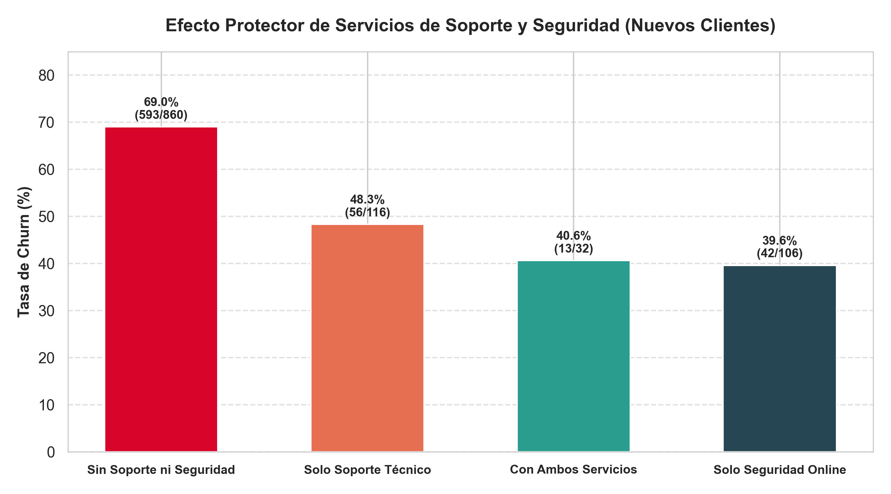
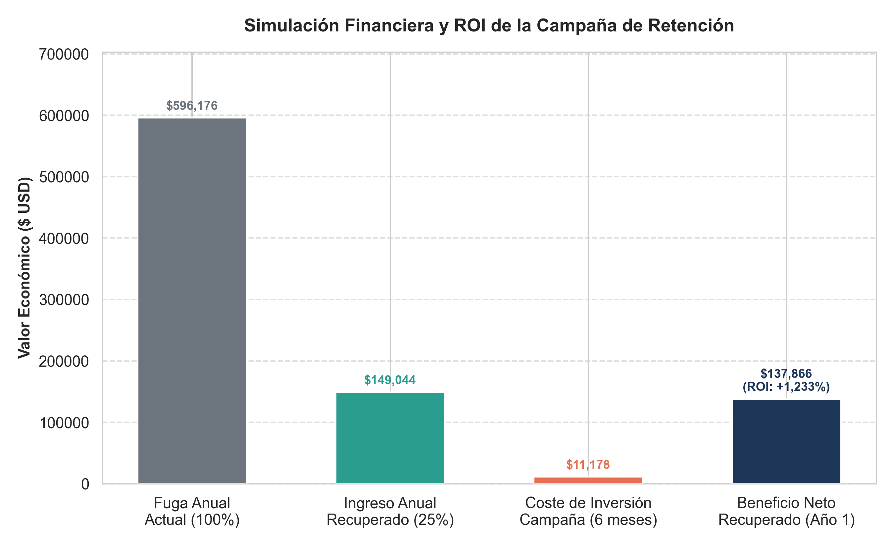

# 📉 Análisis Estratégico de Retención de Clientes (Telco Customer Churn con SQL)

[](https://www.python.org/)
[](https://www.sqlite.org/)
[](https://en.wikipedia.org/wiki/SQL)
[](https://pandas.pydata.org/)
[](https://seaborn.pydata.org/)
[](https://tu-portfolio-lovable.app)
[](LICENSE)

> **Declaración de Rol:** *"Ayudo a los equipos de Marketing, Producto y Finanzas a frenar la fuga recurrente de ingresos (MRR) identificando segmentos críticos de abandono de clientes mediante análisis avanzado en SQL y modelado cuantitativo de ROI."*

---

## 🌐 Visualización Interactiva en Mi Web de Lovable

Recruiters y visitantes pueden explorar este proyecto de forma interactiva con dashboards y resumen ejecutivo directamente en mi plataforma web desarrollada con **Lovable**:

👉 **[Explorar este Proyecto en mi Web de Lovable](https://tu-portfolio-lovable.app)** *(Nota: Reemplaza este enlace con tu URL personalizada de Lovable)*  
👉 **[Leer el Dossier Específico para Recruiters (INFORME_EJECUTIVO_RECRUITERS.md)](INFORME_EJECUTIVO_RECRUITERS.md)**

---

## 📌 1. El Problema de Negocio y Pregunta Central

En los modelos de negocio por suscripción (SaaS, Telecomunicaciones, Utilities), **el coste de adquisición de clientes (CAC) supera con creces el coste de retención**. Un cliente que se da de baja prematuramente no solo destruye el valor del ciclo de vida del cliente (*Customer Lifetime Value - LTV*), sino que genera pérdidas operativas no amortizadas.

* **Conjunto de Datos:** Telemetría oficial de **7,043 clientes** de telecomunicaciones con 21 atributos (servicios contratados, modalidades de facturación, contratos, cargos y bajas).
* **Pregunta Central de Negocio:**
  > *¿Qué combinación de tipo de contrato y antigüedad concentra las mayores pérdidas mensuales de ingresos por abandono (MRR), cuáles son los factores causales operativos que lo aceleran y cuál es el impacto financiero y ROI de una campaña de retención temprana?*

---

## 📊 2. Cuadro de Mando Ejecutivo (KPIs Principales)

| Métrica Clave | Valor Observado | Impacto en el Negocio |
| :--- | :--- | :--- |
| **Pérdida Total de Ingresos (MRR Fuga)** | **$139,130.85 USD / mes** | Representa **$1,669,570.20 USD anuales** en ingresos destruidos. |
| **Foco Crítico de Concentración** | **Month-to-month $\le$ 6 meses** | Concentra el **35.7% de toda la fuga de dinero** de la empresa ($49,681.30 USD/mes). |
| **Tasa de Abandono Temprano** | **55.2% de churn** | Más de la mitad de los clientes nuevos en contratos mensuales cancelan en el primer semestre. |
| **Nicho Más Sangrante** | **Fibra Óptica + Cheque Electrónico** | Alcanza un **75.5% de abandono** (332 de 440 clientes cancelaron). |
| **Factor Protector Causal** | **Soporte Técnico + Seguridad Online** | Clientes sin estos servicios sufren **69.0% de churn** vs 39.6% cuando los tienen. |
| **ROI Proyectado de Retención** | **+1,233.3%** | Rescatar solo al 25% de los clientes en riesgo genera **$137,865.61 USD de beneficio neto** en el Año 1. |

---

## 📈 3. Visualizaciones y Hallazgos Clave

### 🔍 Hallazgo 1: Concentración de Fuga en Clientes Nuevos Sin Permanencia
El tipo de contrato es la variable determinante del abandono. Mientras que los clientes con contratos de 1 y 2 años tienen deserciones menores al 12% y 3%, los clientes sin permanencia (**Month-to-month**) acumulan la práctica totalidad de las cancelaciones. Dentro de este grupo, **los primeros 6 meses son la zona de máximo riesgo**, costándole a la empresa casi **$50,000 USD cada mes**.



---

### 🔍 Hallazgo 2: Fricción en el Método de Pago y Alta Sensibilidad al Precio
Al diseccionar el segmento crítico (0 a 6 meses sin permanencia), se observa una clara correlación entre el tipo de conectividad y el canal de facturación:
- **Fibra Óptica:** Tiene facturas mensuales más elevadas (~$80-$90 USD/mes).
- **Cheque Electrónico (`Electronic check`):** Es un método manual no domiciliado que obliga al usuario a realizar un pago consciente cada mes. La combinación de factura elevada + fricción manual dispara el abandono al **75.5%**.



---

### 🔍 Hallazgo 3: La Carencia de Servicios de Asistencia y Seguridad
De los 780 clientes que cancelaron en el segmento crítico, **593 usuarios (el 76%) no tenían contratado ni Soporte Técnico ni Seguridad Online**. La falta de una experiencia de asistencia temprana acelera la frustración ante incidencias de instalación o configuración de red.



---

### 🔍 Hallazgo 4: Simulación Financiera y Retorno de Inversión (+1,233% ROI)
Proponemos una **estrategia de retención proactiva en el tercer mes (Día 75)**. Modelamos el impacto financiero con una hipótesis prudente de rescatar únicamente a 1 de cada 4 clientes en riesgo (25% de efectividad):

- **Ingresos Anuales Protegidos (25% clientes):** $149,043.90 USD.
- **Inversión en Campaña (15% descuento durante 6 meses):** $11,178.29 USD.
- **Beneficio Neto Año 1:** **$137,865.61 USD**.
- **Retorno sobre la Inversión:** **+1,233.3%**.



---

## 🎯 4. Plan de Acción de Retención (The Playbook)

Con base en la evidencia cuantitativa, proponemos al equipo directivo un plan de 3 acciones inmediatas:

1. **Disparador Automatizado en el Día 75 (Mes 3):**
   - Configurar en el CRM/Hubspot/Salesforce un disparador que identifique a usuarios con contrato mensual y servicio de Fibra Óptica que pagan mediante cheque electrónico.
2. **Oferta Comercial de Retención Condicionada:**
   - Ofrecer un **15% de descuento en la factura durante 6 meses** a cambio de:
     - Aceptación de **contrato de permanencia anual (One-year contract)**.
     - Domiciliación de pago mediante **tarjeta bancaria o domiciliación en cuenta**.
3. **Onboarding de Alto Valor (Free Tier):**
   - Incorporar de forma promocional gratuita durante 3 meses el servicio de **Soporte Técnico 24/7 y Protección Antivirus**, reduciendo el abandono derivado de incidencias técnicas tempranas.

---

## 📁 5. Estructura del Repositorio

El proyecto sigue una arquitectura modular y profesional de ingeniería de datos y analítica:

```text
telco-churn-sql/
│
├── .gitignore                                 # Exclusiones optimizadas para Python, Jupyter y SO
├── LICENSE                                    # Licencia abierta MIT
├── README.md                                  # Documentación técnica y ejecutiva principal
├── requirements.txt                           # Dependencias del proyecto (pandas, matplotlib, seaborn, etc.)
├── INFORME_EJECUTIVO_RECRUITERS.md            # Dossier especializado para reclutadores y hiring managers
├── contexto_del_proyecto_sql.md               # Especificaciones y alcance del proyecto
│
├── data/
│   ├── WA_Fn-UseC_-Telco-Customer-Churn.csv   # Dataset oficial de clientes (7,043 registros)
│   └── telco_churn.db                         # Base de datos SQLite generada e indexada
│
├── queries/                                   # Consultas SQL analíticas
│   ├── 01_tasa_churn_contrato_antiguedad.sql  # Consulta 1: Tasa de abandono y MRR perdido
│   ├── 02_segmento_critico_riesgo.sql         # Consulta 2: Segmento de mayor riesgo (0-6m sin permanencia)
│   ├── 03_friccion_soporte_seguridad.sql      # Consulta 3: Diagnóstico causal (carencia de soporte)
│   └── 04_simulacion_roi_retencion.sql        # Consulta 4: Modelo financiero y ROI de la campaña
│
├── src/                                       # Código fuente modular
│   ├── __init__.py                            # Inicializador del paquete
│   ├── cargar_datos.py                        # Pipeline ETL: Extracción, limpieza, tipado e índices SQLite
│   ├── ejecutar_analisis.py                   # Motor de ejecución SQL, exportación de CSVs y reportes
│   └── generar_visualizaciones.py             # Generador de gráficos de alta resolución (300 DPI)
│
├── outputs/                                   # Artefactos generados automáticamente
│   ├── 01_tasa_churn_contrato_antiguedad.csv
│   ├── 02_segmento_critico_riesgo.csv
│   ├── 03_friccion_soporte_seguridad.csv
│   ├── 04_simulacion_roi_retencion.csv
│   ├── grafico_01_mrr_perdido_contrato.png
│   ├── grafico_02_segmento_riesgo_pago.png
│   ├── grafico_03_soporte_seguridad.png
│   ├── grafico_04_simulacion_roi.png
│   └── informe_de_analisis.md                 # Informe ejecutivo consolidado en Markdown
│
├── analisis_sql.ipynb                         # Cuaderno Jupyter paso a paso con SQL interactivo
├── cargar_datos.py                            # Wrapper de ejecución rápida en la raíz
├── ejecutar_analisis.py                       # Wrapper de ejecución rápida en la raíz
├── load_data.py                               # Wrapper de compatibilidad directa
└── run_analysis.py                            # Wrapper de compatibilidad directa
```

---

## 🛠️ 6. Instalación y Reproducción Local en 3 Pasos

### Paso 1: Clonar el repositorio
```bash
git clone https://github.com/Dalvarez78/telco-churn-sql.git
cd telco-churn-sql
```

### Paso 2: Crear entorno virtual e instalar dependencias
```bash
# En Windows (PowerShell)
python -m venv .venv
.venv\Scripts\activate

# En macOS / Linux
python3 -m venv .venv
source .venv/bin/activate

# Instalar librerías requeridas
pip install -r requirements.txt
```

### Paso 3: Ejecutar el pipeline analítico completo
Con solo dos comandos recreas la base de datos indexada, ejecutas todas las consultas, exportas los datos y generas todos los gráficos:

```bash
# 1. Ingesta y limpieza en SQLite
python cargar_datos.py

# 2. Ejecución de consultas, generación de gráficos e informes
python ejecutar_analisis.py
```

*Opcional:* Abre el cuaderno interactivo en Jupyter:
```bash
jupyter notebook analisis_sql.ipynb
```

---

## 💼 7. Para Reclutadores y Equipos de Selección

Si estás evaluando mi candidatura para roles de **Data Analyst**, **BI Analyst**, **Analytics Engineer** o **Junior Data Scientist**, este proyecto demuestra mi enfoque de trabajo:

- [x] **Traducción de Datos a Negocio:** No presento números aislados; cuantifico el impacto en **MRR**, **ARR** y **Retorno de Inversión (ROI)**.
- [x] **Dominio de SQL Relacional:** Manejo fluido de agregaciones condicionales, expresiones de tabla comunes (**CTEs**), indexación y normalización.
- [x] **Ingeniería de Software y Calidad de Código:** Modularidad en carpetas (`src/`, `data/`, `queries/`), control de errores, tipado estricto y documentación exhaustiva en español.
- [x] **Capacidad de Comunicación:** Capacidad demostrada para presentar conclusiones accionables tanto a equipos técnicos como a perfiles ejecutivos (C-Level).

📄 **Para más detalles técnicos y preguntas típicas de entrevista resueltas, consulta [INFORME_EJECUTIVO_RECRUITERS.md](INFORME_EJECUTIVO_RECRUITERS.md).**

---

## 👤 Autor

* **David Álvarez** — Data Analyst & Software Developer
* **Web Portfolio en Lovable:** [Ver en Lovable](https://tu-portfolio-lovable.app)
* **GitHub:** [@Dalvarez78](https://github.com/Dalvarez78)
* **Licencia:** Distribuido bajo la Licencia MIT. Consulta el archivo [LICENSE](LICENSE) para más información.
