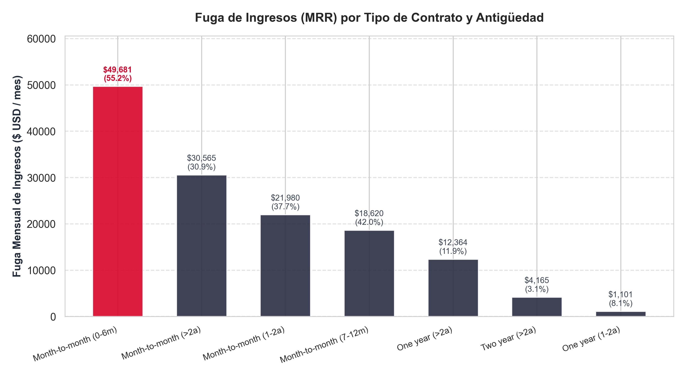
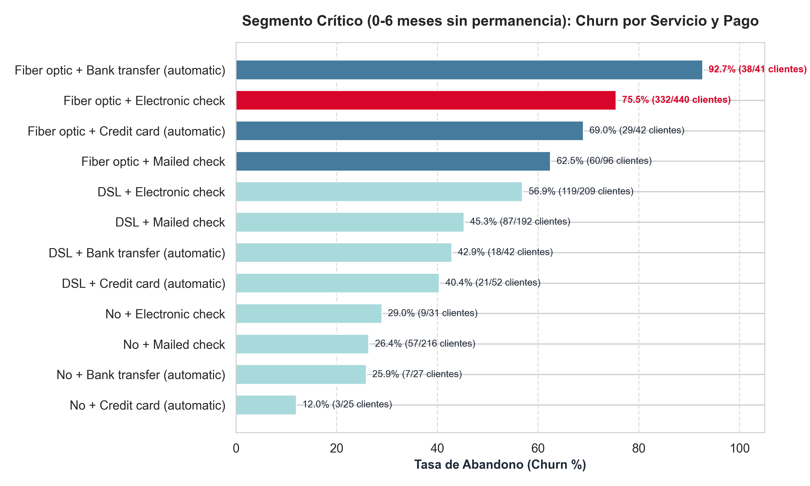
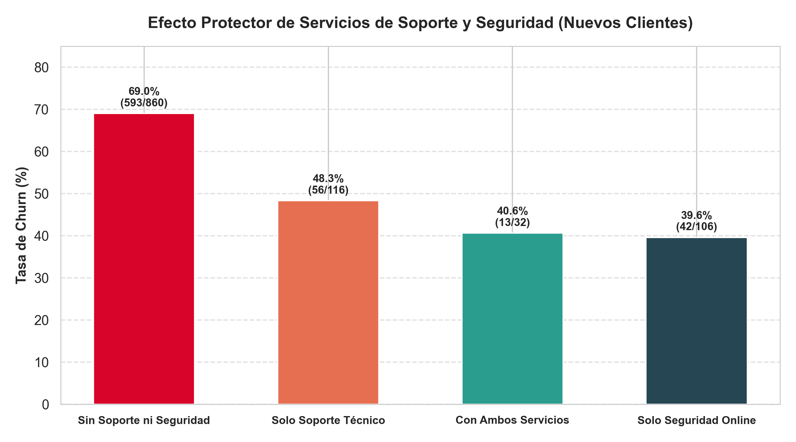
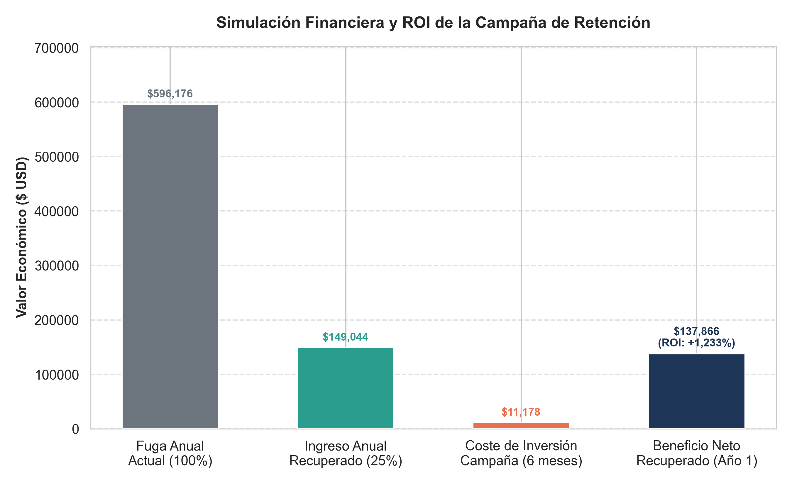

# Informe Ejecutivo de Retención: Telco Customer Churn

> **Declaración del Rol:** *Ayudo a los equipos de Marketing, Producto y Retención a blindar el flujo de ingresos recurrentes (MRR) identificando segmentos críticos de fuga de clientes mediante análisis avanzado en SQL.*

---

## 1. Resumen Ejecutivo y Pregunta de Negocio

En la industria de telecomunicaciones, el coste de adquisición de clientes (CAC) supera con creces el coste de retención. En este estudio analizo la telemetría de **7,043 clientes**, identificando la fuga de ingresos (*churn*) y diseñando una estrategia cuantitativa de alto impacto.

* **Pregunta Central:** ¿Qué combinación de contrato y antigüedad concentra la mayor fuga mensual de ingresos, cuáles son los factores causales que la aceleran y qué retorno sobre la inversión (ROI) ofrece una campaña de retención temprana?

### Principales Indicadores Clave (KPIs)
- **Fuga Total de Ingresos (MRR):** $139,130.85 USD / mes ($1,669,570.20 USD anualizados).
- **Foco Crítico:** Contratos mes a mes de 0 a 6 meses concentran **$49,681.30 USD/mes** (35.7% de la pérdida total).
- **Tasa de Abandono en el Foco:** **55.2%** de abandono temprano (780 de 1,413 clientes cancelan en el primer semestre).
- **Nicho Más Crítico:** Fibra Óptica + Cheque Electrónico alcanza **75.5% de churn**.
- **ROI Proyectado de Retención:** **+1,233%** rescatando solo al 25% de los clientes en riesgo.

---

## 2. Fuga de Ingresos por Tipo de Contrato y Antigüedad

Evaluación del impacto financiero directo según la permanencia pactada y los meses de relación comercial con la empresa.

| tipo_contrato  | rango_antiguedad | total_clientes | clientes_cancelados | tasa_churn_pct | ingresos_mensuales_perdidos | pct_del_total_fuga |
| -------------- | ---------------- | -------------- | ------------------- | -------------- | --------------------------- | ------------------ |
| Month-to-month | 0-6 meses        | 1,413          | 780                 | 55.20          | 49,681.30                   | 35.70              |
| Month-to-month | Más de 2 años    | 1,144          | 353                 | 30.90          | 30,565.35                   | 22                 |
| Month-to-month | 1-2 años         | 737            | 278                 | 37.70          | 21,980.30                   | 15.80              |
| Month-to-month | 7-12 meses       | 581            | 244                 | 42             | 18,620.15                   | 13.40              |
| One year       | Más de 2 años    | 1,152          | 137                 | 11.90          | 12,364.30                   | 8.90               |
| Two year       | Más de 2 años    | 1,537          | 48                  | 3.10           | 4,165.30                    | 3                  |
| One year       | 1-2 años         | 197            | 16                  | 8.10           | 1,101.35                    | 0.80               |
| One year       | 7-12 meses       | 85             | 9                   | 10.60          | 438                         | 0.30               |
| One year       | 0-6 meses        | 39             | 4                   | 10.30          | 214.80                      | 0.20               |
| Two year       | 0-6 meses        | 29             | 0                   | 0              | 0                           | 0                  |
| Two year       | 1-2 años         | 90             | 0                   | 0              | 0                           | 0                  |
| Two year       | 7-12 meses       | 39             | 0                   | 0              | 0                           | 0                  |

### Hallazgos de la Consulta 1:
- **Concentración del Riesgo:** El 55.2% de los clientes en contratos mensuales se dan de baja en los primeros 6 meses.
- **Efecto Blindaje:** Los contratos de 1 y 2 años muestran tasas de churn inferiores al 12% y 3% respectivamente, demostrando que la permanencia contractual es el mayor escudo de retención.

---

## 3. Radiografía del Segmento Crítico: Servicios y Fricción de Pago

Filtrando exclusivamente la cohorte más vulnerable (contrato mes a mes, antigüedad $\le$ 6 meses), analizamos la intersección de servicios de conectividad y canales de recaudación.

| servicio_internet | metodo_pago               | total_clientes | cancelaciones | tasa_churn_pct | mrr_perdido_segmento | cuota_mensual_promedio |
| ----------------- | ------------------------- | -------------- | ------------- | -------------- | -------------------- | ---------------------- |
| Fiber optic       | Electronic check          | 440            | 332           | 75.50          | 26,920.80            | 80.80                  |
| DSL               | Electronic check          | 209            | 119           | 56.90          | 5,213.10             | 45.63                  |
| DSL               | Mailed check              | 192            | 87            | 45.30          | 3,964.40             | 45.97                  |
| Fiber optic       | Mailed check              | 96             | 60            | 62.50          | 4,731.40             | 79.36                  |
| No                | Mailed check              | 216            | 57            | 26.40          | 1,144.85             | 20.26                  |
| Fiber optic       | Bank transfer (automatic) | 41             | 38            | 92.70          | 3,098.65             | 81.59                  |
| Fiber optic       | Credit card (automatic)   | 42             | 29            | 69             | 2,399.30             | 80.81                  |
| DSL               | Credit card (automatic)   | 52             | 21            | 40.40          | 1,006.15             | 49.71                  |
| DSL               | Bank transfer (automatic) | 42             | 18            | 42.90          | 816                  | 48.84                  |
| No                | Electronic check          | 31             | 9             | 29             | 179.35               | 20.05                  |
| No                | Bank transfer (automatic) | 27             | 7             | 25.90          | 146.75               | 20.24                  |
| No                | Credit card (automatic)   | 25             | 3             | 12             | 60.55                | 20.11                  |

### Hallazgos de la Consulta 2:
- **Fibra Óptica:** Tiene una cuota mensual más elevada (~$80-$90 USD/mes), lo que incrementa la sensibilidad al precio en los primeros meses.
- **Cheque Electrónico (`Electronic check`):** Es un método de pago manual no automatizado. Cada mes el cliente experimenta 'fricción de pago', evaluando conscientemente si renovar o cancelar. Esto dispara el abandono al **75.5%** (332 cancelaciones en 440 clientes).

---

## 4. Diagnóstico Causal: La Carencia de Soporte Técnico y Seguridad Online

¿Por qué se van tan rápido los clientes de fibra óptica? El análisis de servicios complementarios revela una causa operativa directa:

| estado_soporte_tecnico | estado_seguridad_online | total_clientes | clientes_cancelados | tasa_churn_pct | mrr_perdido |
| ---------------------- | ----------------------- | -------------- | ------------------- | -------------- | ----------- |
| Sin Soporte Técnico    | Sin Seguridad Online    | 860            | 593                 | 69             | 40,638.40   |
| Sin Internet           | Sin Internet            | 299            | 76                  | 25.40          | 1,531.50    |
| Con Soporte Técnico    | Sin Seguridad Online    | 116            | 56                  | 48.30          | 4,004.80    |
| Sin Soporte Técnico    | Con Seguridad Online    | 106            | 42                  | 39.60          | 2,684.50    |
| Con Soporte Técnico    | Con Seguridad Online    | 32             | 13                  | 40.60          | 822.10      |

### Hallazgos de la Consulta 3:
- **Desamparo Técnico:** De los 780 cancelados en el segmento crítico, **593 clientes (el 76%) no contaban con Soporte Técnico ni Seguridad Online**.
- **Tasa de Abandono Sin Soporte:** Alcanza un dramático **69.0%**, frente a un 39.6% cuando cuentan con protección y asistencia técnica.

---

## 5. Simulación de Negocio y Retorno sobre la Inversión (ROI)

Para presentar a la dirección general, construimos un modelo financiero proyectando el impacto de una campaña automatizada de retención en el tercer mes.

| clientes_perdidos_historicos | mrr_perdido_mensual | fuga_ingresos_anuales | meta_clientes_rescatados_25pct | ingreso_anual_protegido | coste_inversion_campana | beneficio_neto_anual_recuperado | roi_campana_pct |
| ---------------------------- | ------------------- | --------------------- | ------------------------------ | ----------------------- | ----------------------- | ------------------------------- | --------------- |
| 780                          | 49,681.30           | 596,175.60            | 195                            | 149,043.90              | 11,178.29               | 137,865.61                      | 1,233.30        |

### Propuesta Estratégica (The Retention Playbook):
1. **Disparador Automatizado (Día 75 / Mes 3):** Identificar a los usuarios de fibra óptica en contrato mensual que pagan por cheque electrónico y carecen de soporte técnico.
2. **Oferta Comercial de Retención:** Ofrecer un **15% de descuento en la factura durante 6 meses** condicionado a dos factores innegociables:
   - Migración a contrato con **permanencia anual** (One-year contract).
   - Domiciliación del pago vía **tarjeta bancaria o cuenta automática** (eliminando la fricción del cheque electrónico).
3. **Onboarding con Valor Agregado:** Incluir sin coste adicional durante 3 meses el paquete de **Soporte Técnico y Seguridad Web**.
4. **Impacto Financiero Proyectado:** Rescatando únicamente a 1 de cada 4 clientes en riesgo (25%), la compañía protege **$149,043.90 USD/año**, incurriendo en una inversión comercial de tan solo $11,178.29 USD en descuentos, arrojando un **beneficio neto de $137,865.61 USD** y un **ROI del +1,233%**.
